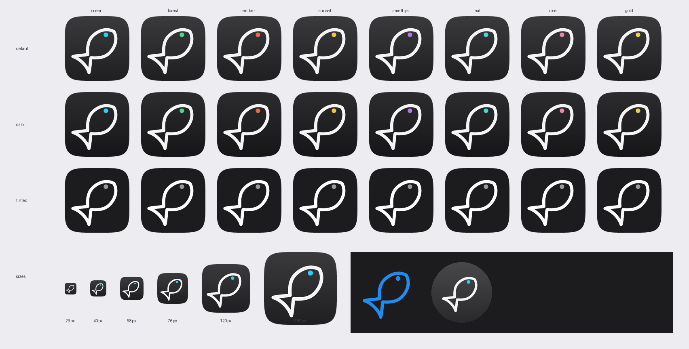

# Currents app icon



A fish drawn as a single monoline outline, nose pointing up-right at 45°, with
a solid dot for the eye. The outline is white; the eye is the one accent and
carries the theme colour. It sits on the charcoal that Apple's own iOS 26
dark-appearance icons use.

Everything in this folder and every icon PNG in the app is generated from one
set of control points in [`scripts/render_app_icon.py`](../../scripts/render_app_icon.py):

```
pip install cairosvg pillow numpy
python scripts/render_app_icon.py          # all PNGs, SVGs, this preview
python scripts/render_app_icon.py --swift  # ios/Shared/CurrentsMark.swift
```

The SwiftUI `CurrentsMark` view is emitted from the same curves, so the logo
inside the app, on the watch and in share cards is the icon, not a redraw of it.

## Why this mark

The brief: a sleek, simple icon in the spirit of Apple's dark system icons,
tied to fishing, with a diagonal outlined fish glyph as the direct reference.

**What the reference icons have in common** (Clock, Calendar, the "m" app):

- One big, centred glyph that fills roughly two thirds of the tile.
- Near-black charcoal, not pure black: sampled at `#38383A` at the top fading
  to `#202022` at the bottom. Pure black kills the Liquid Glass edge light.
- White as the dominant colour, with exactly one accent (Clock's orange second
  hand, Calendar's red "Fri"). Never more than two colours.
- Round, even stroke weights. No outlines around filled shapes, no gradients
  inside the glyph, no text.

**What the reference glyph taught us.** Measured from the supplied image: the
stroke is about 4.5% of the glyph's size, the eye about 12%, and the fish sits
at 45° with the tail in the bottom-left corner. The first attempt used an 8%
stroke and the tail lobes merged into a blob at 40px; at 5.5% the tail stays
open at every size. The body is a long teardrop that tapers continuously to a
narrow peduncle, with a wide fan tail and a shallow concave trailing edge.
The glyph is an original drawing with those proportions, not a trace: Apple's
SF Symbols licence does not allow their symbols in App Store icons.

**What the Human Interface Guidelines ask for** (App icons, June 2026 revision):

- "Find a concept or element that captures the essence of your app… express it
  in a simple, unique way with a minimal number of shapes." Two shapes.
- "Avoid extremely thin line weights and sharp corners." The stroke is 49px at
  1024 and every join is rounded.
- "Keep your icon's core visual features the same in the default, dark, clear,
  and tinted appearances." The three variants only change the background
  falloff and swap the eye for a grey in tinted mode.
- "Alternate app icons in iOS and iPadOS require their own dark, clear, and
  tinted variants." Every theme set ships all three.
- watchOS: "Avoid using black for your icon's background." The watch icon uses
  a lighter charcoal and the mark is scaled to 72% so the tail clears the
  circular mask.
- Let the system draw highlights, shadows and blur. The PNGs carry only the
  background gradient; no glow, no bevel.

**The eye is the theme.** The alternate icons (Ocean, Forest, Ember, Sunset,
Amethyst, Teal, Rose, Gold) are one mark with one coloured dot, exactly as the
HIG wants alternates to "remain closely related" and never "be mistaken for
another app." Inside the app the mark is drawn in a single theme colour.

## Files

| Path | Purpose |
|---|---|
| `currents-icon.svg` | Editable source of the default icon (viewBox 0–1). |
| `currents-mark.svg` | The mark alone on a transparent background. |
| `layers/background.svg`, `layers/fish.svg`, `layers/eye.svg` | Separate layers to drop into Icon Composer for a Liquid Glass `.icon`. |
| `preview.png` | Contact sheet: all themes × default/dark/tinted, a size ladder, the in-app mark, the watch icon. |

### Liquid Glass (optional next step)

Xcode 26's Icon Composer produces a layered `.icon` bundle that the system lights
and refracts live. The three SVGs in `layers/` are ready to import: background
as the background layer, then `fish` and `eye` as two foreground layers. Export
the `.icon` next to the asset catalog and point `ASSETCATALOG_COMPILER_APPICON_NAME`
at it; the flat 1024 PNGs stay as the fallback for older systems and for the
App Store listing. This needs a Mac, so it is not wired into CI here.

## Palette

| Role | Value |
|---|---|
| Background, default | `#3A3A3C → #1F1F21` |
| Background, dark | `#2C2C2E → #161618` |
| Background, tinted | `#1C1C1E` flat |
| Background, watch | `#48484A → #2A2A2C` |
| Outline | `#F5F5F7` (pure white in tinted) |
| Eye, tinted | `#9A9A9E` |
| Eye, per theme | the light stop of `ThemeOption.gradient` (`LiquidGlass.swift`), e.g. Ocean `#26D1FA` |
